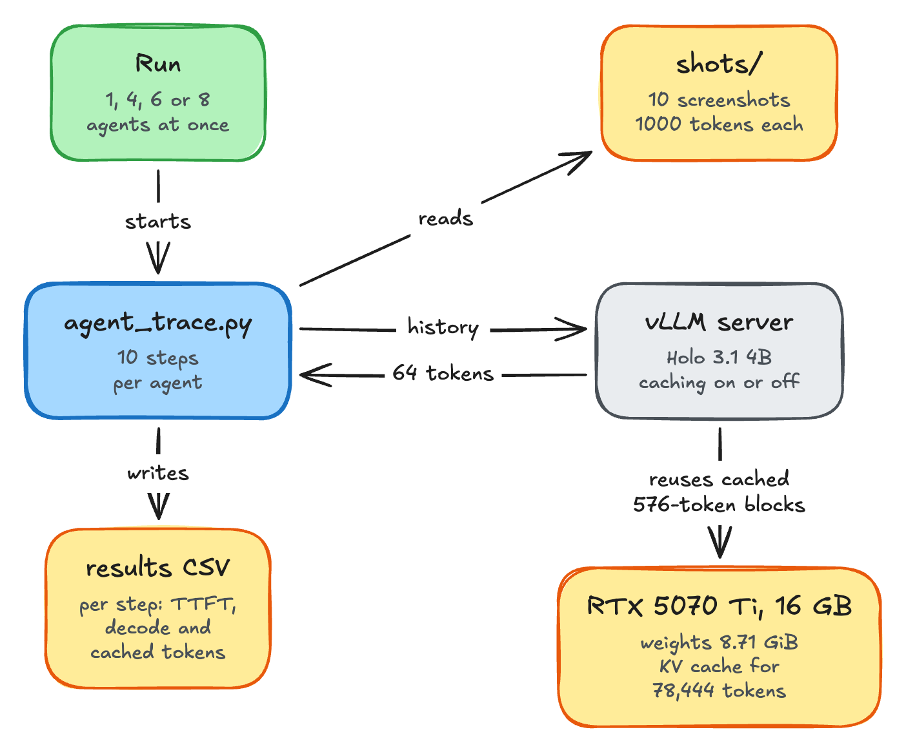

# Computer-use agent on vLLM

Companion code for
[Serving a Computer-Use Agent on a 16 GB GPU with vLLM](https://rdiachenko.com/posts/inference/computer-use-agent-vllm/).
It replays a 10-step computer-use agent run against
[Holo 3.1 4B](https://huggingface.co/Hcompany/Holo-3.1-4B) served by vLLM, with prefix caching on
and off, and with 1 to 8 agents at once. The post covers the predictions, the measurements and why
each number came out the way it did.

How the pieces fit together:

<picture>
  <source media="(prefers-color-scheme: dark)" srcset="docs/diagrams/overview-dark.png">
  
</picture>

Measured on an RTX 5070 Ti (16 GB, 896 GB/s), driver 610.43, Ubuntu 26.04, Python 3.14, vLLM
0.33.0, PyTorch 2.14 with CUDA 13.0. `data/requirements.lock` pins every package.

## Results

1 agent, 10 steps, mean of 3 runs each:

| | Caching off | Caching on |
|---|---|---|
| Prompt at step 10 | 10,350 tokens | 10,350 tokens, 9,216 of them cached |
| Time to first token at step 10 | 1,099 ms | 229 ms |
| Step 10, including 64 generated tokens | 1,835 ms | 965 ms |
| All 10 steps | 13.55 s | 9.48 s |

Several agents at once, caching on:

| Agents | Wall time | Generated tokens per second |
|---|---|---|
| 1 | 9.5 s | 68 |
| 4 | 15.4 s | 166 |
| 6 | 26.3 s | 146 |
| 8 | 57.2 s | 90 |

Decode runs at 11.3 ms per token, 84% of the card's memory bandwidth. Past 4 agents the KV cache
fills up, vLLM queues requests and reuses less cached history, and throughput falls.

## Run it

```bash
sudo apt install python3-dev   # Triton compiles a helper against Python's headers
uv venv --python 3.14 && source .venv/bin/activate
uv pip install vllm==0.33.0 --torch-backend=auto
```

Start the server with prefix caching on:

```bash
vllm serve Hcompany/Holo-3.1-4B \
  --dtype bfloat16 \
  --max-model-len 32768 \
  --max-num-seqs 16 \
  --gpu-memory-utilization 0.85 \
  --limit-mm-per-prompt '{"image": 10}' \
  --enable-prompt-tokens-details \
  --enable-prefix-caching
```

Without `--max-num-seqs 16`, vLLM runs out of memory on a 16 GB card while capturing CUDA graphs.
For the "off" runs, restart it with `--disable-prefix-caching`. Then, in a second terminal:

```bash
python one_request.py             # 1 screenshot: token counts, time to first token, decode speed
python agent_trace.py on 1        # 1 agent, 10 steps, appended to results-1-agents.csv
python agent_trace.py on 4        # 4 agents at once, appended to results-4-agents.csv
python summarise.py results-1-agents.csv
```

The first argument of `agent_trace.py` labels the server setup (`on` or `off`) and the second is the
number of agents. `summarise.py` averages each step across runs and prints the on/off table.
`python summarise.py data/results-1-agents.csv` rebuilds the table above from the published runs.

`python list_tensors.py` doesn't need the server. It reads the downloaded model files and prints
the parameters and GiB per group of tensors, which is how the duplicated embedding table showed up.

## Files

| File | Holds |
|---|---|
| `agent_trace.py` | The replay: N agents in parallel, 10 steps each, timing every step |
| `summarise.py` | Per-step means across runs, as a markdown table |
| `one_request.py` | One request with one screenshot, as a first check |
| `list_tensors.py` | Parameters and size per group of tensors in the downloaded model files, which found the duplicated embedding table |
| `shots/` | The 10 screenshots, 1280 × 803, from a British Library opening hours task |
| `predictions.md` | What I expected before measuring, then what I measured and why it differed |
| `data/results-1-agents.csv` | 3 runs with caching off and 3 with it on, 1 agent |
| `data/results-{4,6,8}-agents.csv` | The concurrent runs, caching on |
| `data/results-image-cache-warm.csv` | Earlier 1-agent runs that reused screenshots across runs, about 60 ms per step faster than realistic |
| `data/results.md` | The 1-agent table, as printed by `summarise.py` |
| `data/setup.txt`, `data/model-config.json`, `data/requirements.lock` | GPU and versions, the model's config, exact packages |
| `logs/server-off.log`, `logs/server-on.log` | vLLM's output for the measured runs: memory breakdown, KV cache size, block size, queueing |

## How the replay keeps runs comparable

- Each step resends the whole history unchanged and adds to the end, so the prompt is
  append-only and prefix caching can reuse it.
- The actions between screenshots are fixed strings, the ones taken in the real task.
- Every answer is exactly 64 tokens (`max_tokens=64`, `ignore_eos`), so only the prompt varies.
- Every run starts its system prompt with a random ID and changes 1 pixel in each screenshot, so
  no run reuses another run's prefix cache or image cache.
- A warm-up request with a blank image runs first. With caching on, vLLM still compiles one
  kernel on the first request, and the warm-up takes that cost instead of step 1.
