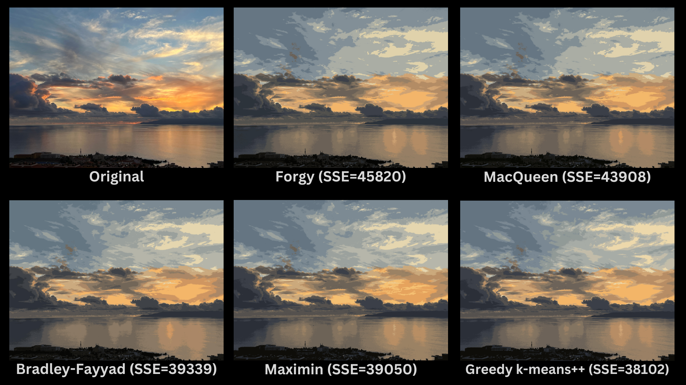

# K-means image compression

K-means clustering applied to image compression, the companion code for [K-Means Image Compression in Rust](https://rdiachenko.com/posts/ml/k-means-image-compression/). The crate implements the algorithm from scratch, with six centroid initialisation strategies and a command-line interface that reduces an image to `K` colours.

Needs Rust 1.85 or later (edition 2024).

## Usage

```bash
cargo run --release -- IMAGE K STRATEGY
```

Where:
- `IMAGE` is the path to your input image file
- `K` is the number of colours to use in the compressed image
- `STRATEGY` is a single letter code for the centroid initialisation strategy:
    - `f` Forgy
    - `m` MacQueen
    - `x` Maximin
    - `b` Bradley-Fayyad
    - `k` K-means++
    - `g` Greedy K-means++

Example:

```bash
cargo run --release -- /path/to/sky.png 16 k
```

This compresses `sky.png` to 16 colours using the K-means++ initialisation strategy.

Run the tests:

```bash
cargo test
```

## Results

The six initialisation strategies on the same image at 16 colours:



1. Compression reduced the image from 4.65 MB to 1.05 MB, a 77.42% reduction.
2. All strategies preserve the overall image structure well with only 16 colours.
3. Greedy k-means++ achieves the lowest sum of squared errors (SSE), closely followed by Maximin and Bradley-Fayyad.
4. MacQueen and Forgy show higher SSE values, a worse fit to the original.
5. The differences are most visible in sky details and colour gradients.

## Documentation

```bash
cargo doc --no-deps --document-private-items --open
```
